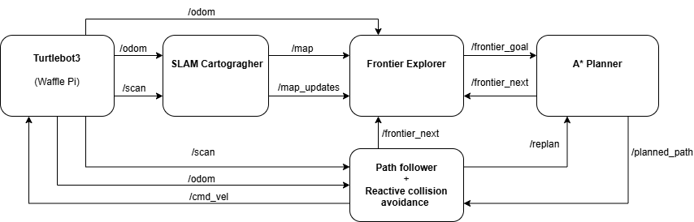
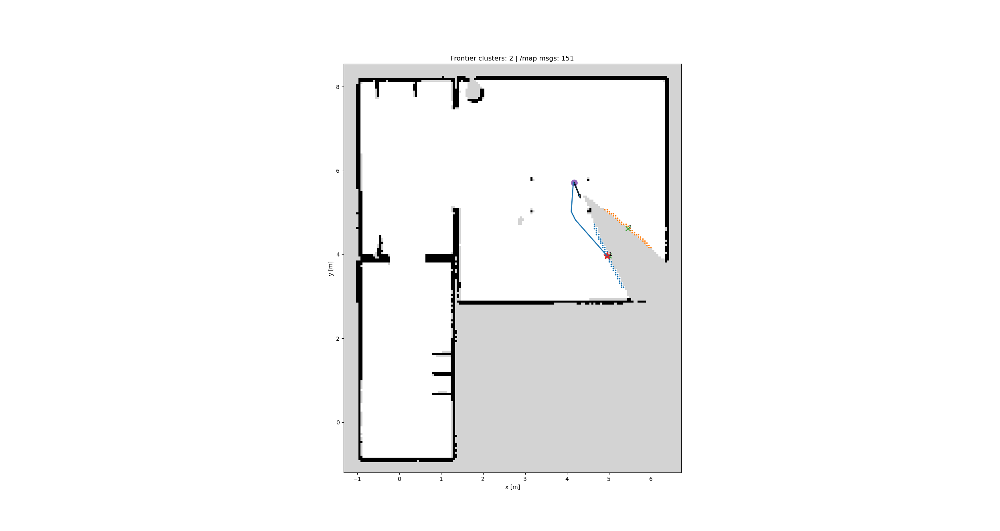
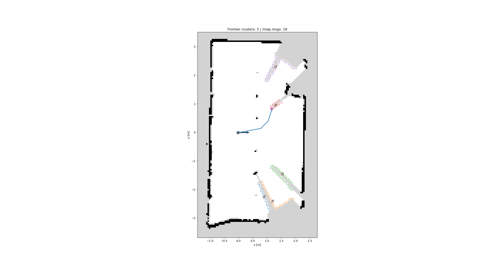

# TurtleBot3 Hybrid Exploration with ROS 2 Jazzy

Autonomous indoor exploration and mapping with a TurtleBot3, combining frontier goal selection, A* global planning, and reactive LiDAR obstacle avoidance. The controller integrates with Cartographer SLAM and was developed in Gazebo before being adapted to a physical TurtleBot3 Waffle Pi.

**Stack:** ROS 2 Jazzy · Python · TurtleBot3 · Cartographer · Gazebo · NumPy · Matplotlib

[Project report](docs/report/mobile-robotics-report.pdf) · [Algorithm pseudocode](docs/algorithms.md) · [Setup and running](docs/setup.md) · [Implementation notes](docs/implementation-notes.md)

[](https://emanual.robotis.com/docs/en/platform/turtlebot3/features/)

*Hardware reference image: ROBOTIS. This project used the Waffle Pi model. The result figures below are from the project report.*

## Overview

The robot explores an initially unknown indoor environment by repeatedly selecting a frontier, planning a route, and following it while responding to nearby obstacles. Global decisions use an occupancy grid, while local obstacle responses use the laser scanner directly.

The custom work is organized into three ROS 2 nodes. Cartographer provides SLAM; the project implements exploration, path planning, and local motion control.

## How it works

| Component | Role | Main techniques |
| --- | --- | --- |
| Frontier selector | Choose where to explore next | Free/unknown boundary detection, eight-connected BFS clustering, obstacle inflation, representative cluster goals, distance ranking |
| A* planner | Find a route to the selected frontier | Eight-connected grid search, nearby goal candidates, partial-route fallback, line-of-sight shortcutting, moving-average smoothing |
| Path follower | Execute the route and react to obstacles | Waypoint tracking, LiDAR sector checks, avoidance states, progress monitoring, replanning and next-frontier requests |

[](docs/report/mobile-robotics-report.pdf)

The **deliberative layer** selects frontiers and plans global routes. The **reactive layer** uses current LiDAR measurements to turn away from nearby obstacles, attempt to rejoin the route, and request recovery when progress stalls.

### Algorithm pseudocode

The [algorithm guide](docs/algorithms.md) presents the six numbered algorithms from the project report as readable pseudocode, plus a summary of the reactive path follower derived from the report and source.

| Stage | Pseudocode |
| --- | --- |
| Frontier goal selection | [Exploration loop, frontier candidates, and goal ranking](docs/algorithms.md#frontier-exploration) |
| Path planning and smoothing | [Planner events, planning pipeline, and A* candidate search](docs/algorithms.md#global-path-planning) |
| Path tracking and obstacle avoidance | [Reactive follower summary](docs/algorithms.md#reactive-path-follower) |

### ROS interfaces

| Topic | Message type | Purpose |
| --- | --- | --- |
| `/map` | `nav_msgs/msg/OccupancyGrid` | SLAM occupancy grid |
| `/map_updates` | `map_msgs/msg/OccupancyGridUpdate` | Incremental updates, when available |
| `/odom` | `nav_msgs/msg/Odometry` | Planner and follower pose input |
| `/scan` | `sensor_msgs/msg/LaserScan` | Reactive obstacle sensing |
| `/frontier_goal` | `geometry_msgs/msg/PoseStamped` | Selected exploration target |
| `/planned_path` | `nav_msgs/msg/Path` | Global route |
| `/cmd_vel` | `geometry_msgs/msg/TwistStamped` | Follower velocity commands |
| `/replan` | `std_msgs/msg/Bool` | Request another route |
| `/frontier_next` | `std_msgs/msg/Bool` | Request another frontier |

The frontier selector obtains robot pose from `map → base_footprint` TF. The planner and follower use odometry directly; their coordinate-frame assumption is explained in the [implementation notes](docs/implementation-notes.md#coordinate-frames).

## Results

### Gazebo house environment

The report describes autonomous exploration, frontier selection, feasible global routes, and path following in the TurtleBot3 house world. The figure shows an intermediate map, colored frontier clusters, robot pose, and a planned path.

[](docs/assets/simulation.png)

*Gazebo result: occupancy grid, detected frontiers, robot pose, and global route. Select the figure to inspect it at full resolution.*

### Physical TurtleBot3 Waffle Pi

The same overall pipeline was adapted to a **Waffle Pi with Raspberry Pi 4 and an LDS-02 360° LiDAR**. The report documents laboratory map expansion and frontier navigation. The figure shows a partially mapped laboratory environment.

[](docs/assets/physical-robot.png)

*Physical-robot result: a partially mapped laboratory with frontier clusters and a path toward the selected goal. Select the figure for the full-resolution view.*

Hardware deployment exposed noisier scans, localization drift, and uncertain returns from reflective or transparent surfaces. Practical tuning included obstacle clearance, sensor QoS, laser beam angles, and velocity limits.

Evaluation is qualitative. The report does not provide measured coverage, completion time, collision rate, or repeated-trial benchmarks.

## Build and run

Use a **ROS 2 Jazzy** environment with the TurtleBot3 and Cartographer dependencies installed. The frontier visualization requires a graphical desktop with Tk support.

From the repository root:

```bash
source /opt/ros/jazzy/setup.bash
rosdep install --from-paths src --ignore-src -r -y
colcon build --symlink-install --packages-select frontier_explorer astar_planner
source install/setup.bash
```

After starting the simulator and Cartographer, the added launcher starts the three custom nodes in one terminal:

```bash
ros2 launch ./launch/exploration.launch.py use_sim_time:=true
```

For the physical robot, use `use_sim_time:=false` after bring-up and SLAM are running. Follow the [setup guide](docs/setup.md) for dependencies, separate terminal commands, interface checks, and configuration details.

## Repository contents

```text
src/
├── frontier_explorer/             # ROS package for frontier goals
├── astar_planner/                 # ROS package for planning and smoothing
└── pathfollower_new555.py          # Tracking and avoidance node
launch/
└── exploration.launch.py          # Added convenience launcher
docs/
├── assets/                       # Report figures and a theme-safe diagram wrapper
├── report/                       # Public copy of the project report
├── algorithms.md                 # Report pseudocode and reactive follower summary
├── setup.md
├── implementation-notes.md
└── submission.md                 # Source provenance and SHA-256 checksums
```

The files under `src/` preserve the original project source. Python caches, build outputs, and the development environment are excluded. Documentation and the launcher were added for this repository; the report title page was replaced to omit the university identifier.

## Limitations and further work

Known edge cases in partial-path handling, coordinate frames, and recovery behavior are documented in the [implementation notes](docs/implementation-notes.md), along with scan freshness and smoothed-path validation concerns.

Future work includes information-gain-aware frontier scoring, smoother local control, consistent TF handling, and quantitative simulation evaluation.

## Verification

The two ROS packages build successfully with colcon. Python syntax, launch argument discovery, internal documentation links, and checksums for all 19 original source/package files have also been checked. These checks do not replace an end-to-end simulation or hardware run.

## Author and acknowledgements

**Author:** [Adhithya Palanisamy Chandrasekaran](https://github.com/ADHU-ADHU)  
**Background:** Developed during master's studies at Umeå University, with a focus on mobile robotics.  
**Project report:** January 25, 2026

The project uses the ROS 2 ecosystem, ROBOTIS TurtleBot3 software, Cartographer SLAM, Gazebo, NumPy, and Matplotlib. Refer to the upstream projects for their documentation and licenses.

- [TurtleBot3 simulation documentation](https://emanual.robotis.com/docs/en/platform/turtlebot3/simulation/) — choose Jazzy.
- [TurtleBot3 bring-up documentation](https://emanual.robotis.com/docs/en/platform/turtlebot3/bringup/) — choose Jazzy.
- [TurtleBot3 Cartographer SLAM documentation](https://emanual.robotis.com/docs/en/platform/turtlebot3/slam/)
